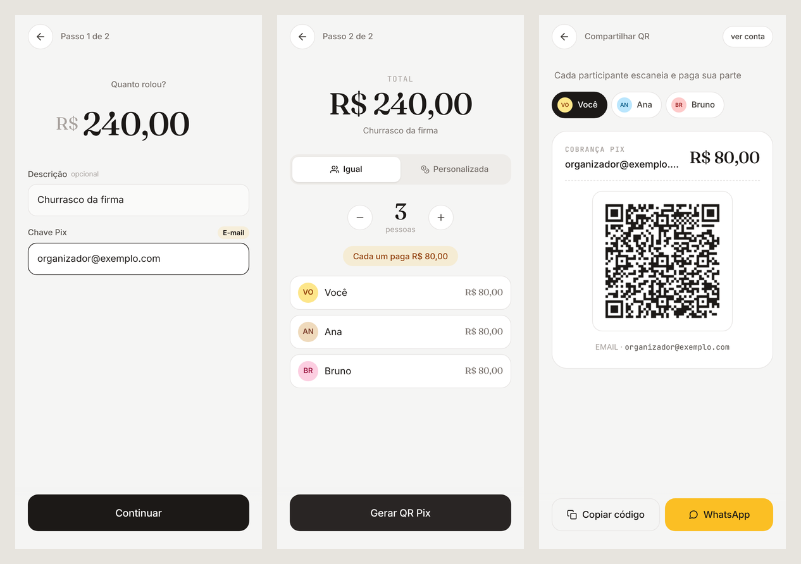

# Yoopix

Divide a conta do rolê e gera o Pix de cada pessoa: QR Code, copia e cola e mensagem pronta para o WhatsApp.

**No ar:** [yoopix.com.br](https://yoopix.com.br)



## O problema

Depois de um churrasco ou de uma viagem, quem pagou a conta ainda tem trabalho: fazer a conta de cada um,
mandar a chave Pix, repetir o valor no grupo e lembrar quem já pagou. O Yoopix junta isso num fluxo de dois
passos. Você informa o valor e a sua chave, escolhe dividir igual ou por pessoa, e cada participante recebe um
Pix com o valor exato dele, por QR Code ou copia e cola, já com a mensagem para o WhatsApp.

## Funcionalidades

- Detecção automática do tipo de chave Pix (CPF, CNPJ, e-mail, telefone, aleatória)
- Divisão igual ou personalizada, com sugestão do valor que falta na personalizada
- Pix BR Code (copia e cola) e QR Code por participante
- Compartilhamento direto no WhatsApp
- Marcar quem já pagou
- Histórico de cobranças no aparelho
- PWA: abre pelo link e instala como app, sem loja

## Stack

- React 19, TypeScript e Vite
- Tailwind CSS, React Router, React Hook Form e Zod
- `pix-utils` (BR Code) e `qrcode`
- `vite-plugin-pwa`
- Deploy na Netlify

## Como rodar

```bash
npm install
npm run dev      # desenvolvimento
npm run build    # build de produção
npm run preview  # pré-visualiza o build
```

## Decisões técnicas

**Sem backend.** O BR Code do Pix é um texto no padrão EMV que dá para montar no próprio navegador, então não
existe servidor. A chave Pix e os valores nunca saem do aparelho, e a política de segurança do site
(`connect-src 'self'` em `netlify.toml`) bloqueia qualquer requisição para fora.

**Pix estático, não dinâmico.** Pix dinâmico confirmaria o pagamento sozinho, mas exige conta num banco ou PSP
e um servidor para receber a notificação. O estático funciona com qualquer chave, e o custo é
que "pago" é marcado à mão.

**Dinheiro em centavos inteiros.** Na divisão igual, o centavo que sobra vai para o último participante
(R$ 100,00 por 3 dá 33,33 + 33,33 + 33,34), e a personalizada só libera o QR quando a soma bate com o total.
Os reais só aparecem na hora de montar o BR Code e na tela.

**Histórico no `localStorage`.** Sem conta e sem login: o histórico é de quem cobrou, no aparelho de quem
cobrou.

## Estrutura

```
src/
├── pages/        Home, NewBill, SplitMode, Result, History
├── components/   TopBar, PixQR, ícones e primitivos de UI
├── hooks/        useBills, useDraft, usePrefs
├── lib/          pix, split, format, storage, validators
└── types/        tipos compartilhados
```
